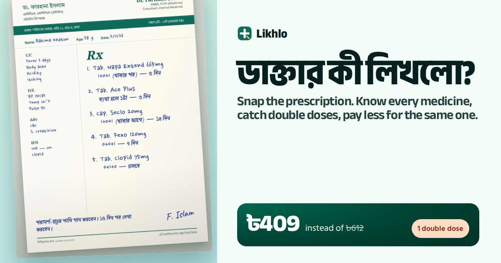

# Likhlo: what did the doctor write, and is there a cheaper same medicine?

**ডাক্তার কী লিখলো?** Snap a Bangladeshi prescription. Likhlo's agent reads every handwritten line, tells you what each medicine is for and when to take it, warns you when two medicines clash, and finds the same medicine for less among 21,714 Bangladeshi brands.

**Live:** https://likhlo-bd.vercel.app · **Code:** this repository



## The problem

In Bangladesh most people pay for medicine out of their own pocket, and a prescription is usually a handwritten slip with brand names and a `1+0+1` dose code. Families can't always read it, nobody tells them that the same medicine is sold by dozens of companies at very different prices, and when two doctors' slips end up on one table, nobody checks whether two brands contain the same thing.

Take **Rahima Khatun's prescription** (a made-up sample, written the way Dhaka chambers write them):

| Line | Written | Likhlo finds |
|---|---|---|
| 1 | Tab. Napa Extend 665mg, 1+0+1 after food, 5 days | Paracetamol. Same tablet from Aceta Extend at ৳1.50 instead of ৳2 |
| 2 | Tab. Ace Plus, ব্যথা হলে ১টা, 3 days | Paracetamol + caffeine: **a second paracetamol** on top of line 1 |
| 3 | Cap. Seclo 20mg, 1+0+1 before food, 14 days | Omeprazole. 123 brands make this capsule; G-Omeprazole is ৳3, not ৳6 |
| 4 | Tab. Fexo 120mg, 0+0+1, 7 days | Fexofenadine. Delfex is ৳5, not ৳8 |
| 5 | Tab. Clopid 75mg, 0+1+0, continue | Clopidogrel. Its leaflet says: *"Avoid concomitant use of omeprazole or esomeprazole"*, which is line 3 |

The same medicines cost **৳409 instead of ৳612** for the days written, and Likhlo flags the double paracetamol and the clopidogrel leaflet warning for the family to show their doctor. For Abdul Karim's monthly diabetes and blood-pressure list, it is **৳798 instead of ৳1,675 every month**.

## For judges (one minute)

1. Open https://likhlo-bd.vercel.app. It opens on Rahima's prescription, already read: the lines marked on the photo, the clash arcs, the price per line and the total.
2. Click **Diabetes and BP, monthly** or **A child's cough syrups** under *Try*. Each replays a recorded real run so you can watch the agent work.
3. Click **Read it live** on the photo caption, or **Read my prescription** to upload any prescription photo. That runs the agent live (about 15 to 25 seconds).
4. Click any medicine to see every brand of the same medicine with its price. Switch **English / বাংলা**, and press **Listen in Bangla** for a spoken summary.
5. Scroll to **Your day** (the medicines placed morning, noon and night) and **What the agent did** (every step, in order).

## How the agent works

One Gemini agent with tools, built on the Vercel AI SDK. The model looks at the photo and decides what to look up; every fact it shows comes back from a tool over the medicine data.

| Step | Tool | What happens |
|---|---|---|
| 1 | `record_lines` | Gemini reads the photo: each medicine line, its box on the image, the `1+0+1` dose, before or after food, the days, "continue" (চলবে) or "when in pain" (ব্যথা হলে) |
| 2 | `search_medicine` | Fuzzy search over 21,714 brands, so a slip of the pen ("Seclo 2O") still matches |
| 3 | `choose_medicine` | The agent picks the brand whose name, strength and form fit the line. Choosing returns the same-medicine brands and prices, and once every line is chosen, the clash check |
| 4 | `check_clashes` | Shared ingredients across lines, and interaction warnings found in each generic's leaflet, quoted word for word (sentences that say "no interaction" are never shown as warnings) |
| 5 | `read_leaflet` | When the prescription shows a child, pregnancy or kidney disease, the agent reads that leaflet section |
| 6 | `finish` | Plain explanations of each medicine in English and Bangla. Money in the summary is replaced by totals computed from the data |

Doses, prices and totals are computed in code from the dataset, never by the model. Each run streams its events to the page as it happens; the samples are recordings of real runs, played back through the same code path. If a model is out of quota, the run moves to the next one (Gemini 3.5 Flash, Gemini 3 Flash, Gemini 3.5 Flash Lite, then Gemini 2.5 Flash through Vercel AI Gateway).

| Judging line | Where you see it |
|---|---|
| Usefulness and clarity of the problem | The first screen: the question, a real-looking prescription, the saving and the clashes |
| Quality and completeness of the working product | Upload any photo; replay, live run, medicine detail, day plan, Bangla audio, phone layout |
| Creativity and strength of the AI/agentic workflow | The marked-up photo and *What the agent did*: read, search, choose, check, explain |
| Technical execution and demo quality | Streaming agent events, recorded runs replayed through the same code, golden tests on every recorded run |
| Potential impact for real users | 21,714 real brands and prices; ৳877 a month saved on one chronic patient's list |

## Run it yourself

```bash
npm install
cp .env.example .env.local   # add one or more Gemini keys from https://aistudio.google.com/apikey
npm run dev                  # http://localhost:3000
```

`npm test` runs the data tests and the golden tests (every number, match and quoted sentence in the recorded runs is checked against the data). `node scripts/build-data.mjs <dir>` rebuilds `data/` from the CSVs; `node scripts/record-run.mjs <id> "<title>"` records a sample run against a running server.

## Data and credits

- **Medicines:** [Medicine Dataset of Bangladesh](https://huggingface.co/datasets/ArnobBot/Medicine-Dataset-of-Bangladesh) (MIT), derived from [MedEx](https://medex.com.bd) via [bd-medicine-scraper](https://github.com/ahmedshahriar/bd-medicine-scraper): 21,714 brands with generic, strength, form, maker and price, and 1,570 generic leaflets. Prices are as listed in that dataset.
- **Models:** Google Gemini (vision and tool calling; Gemini TTS for the Bangla audio), through the Vercel AI SDK, with Vercel AI Gateway as the last fallback.
- **Built with:** Next.js, Vercel AI SDK, zod, vitest; fonts Anek Bangla, Hind Siliguri and Caveat. Coding was done with Claude Code.
- Built during the Agentic Hackathon submission period (1 to 10 November 2026).

## What's real

| Part | Status |
|---|---|
| Brands, generics, strengths, prices and leaflet text (21,714 brands) | Real, from the public dataset above |
| Reading the photo, choosing matches, explanations | Real, live Gemini runs (the three samples are recordings of such runs) |
| Clash warnings | Real: shared ingredients, and leaflet sentences quoted word for word |
| The three sample prescriptions and patients | Made up, written in the style of Dhaka chambers |
| Buying medicine or messaging a doctor | Not built |

Likhlo explains a prescription; it does not replace the doctor or pharmacist, and it never tells anyone to stop or change a medicine.
